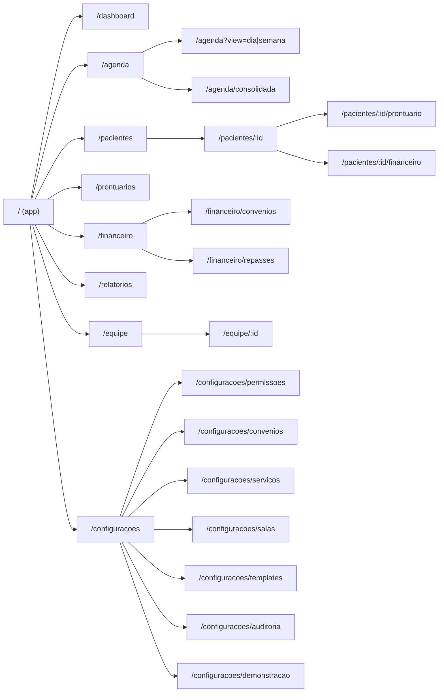
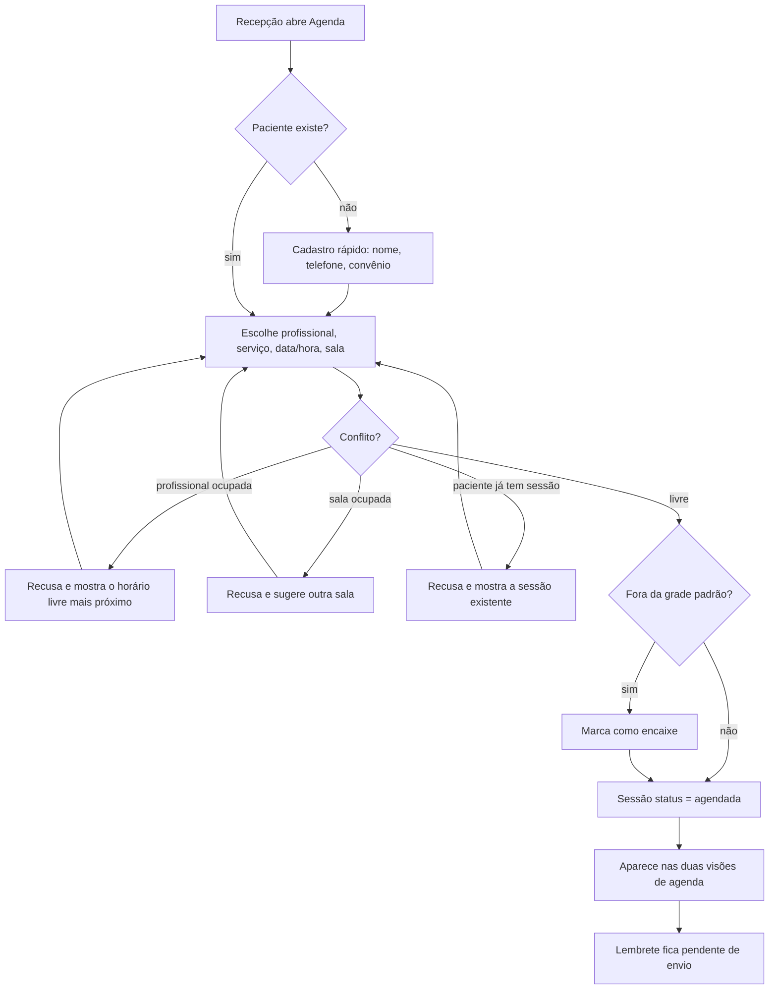
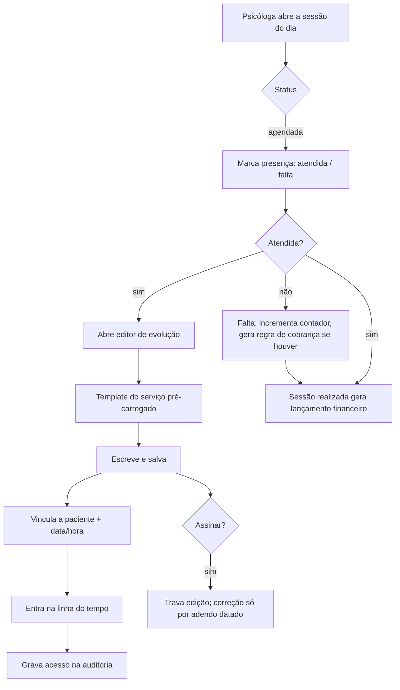
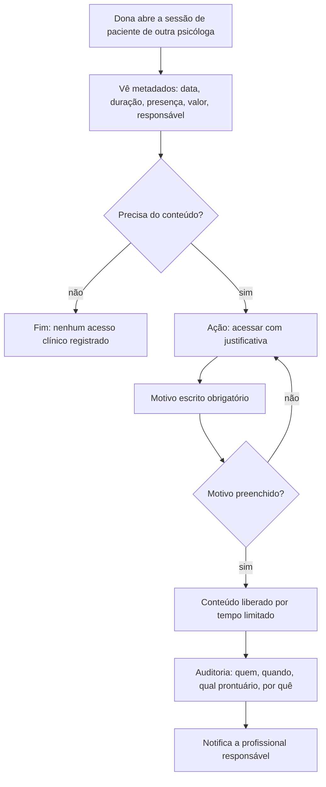
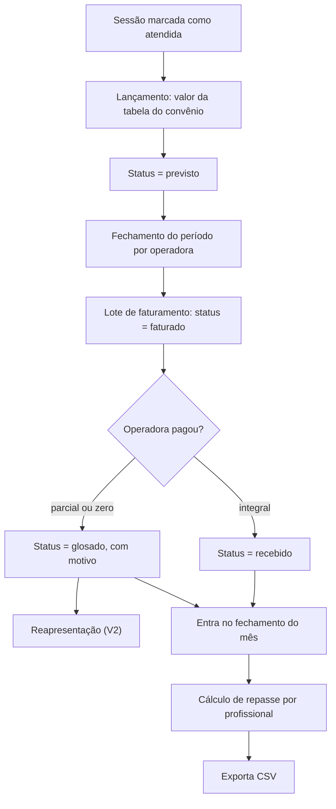
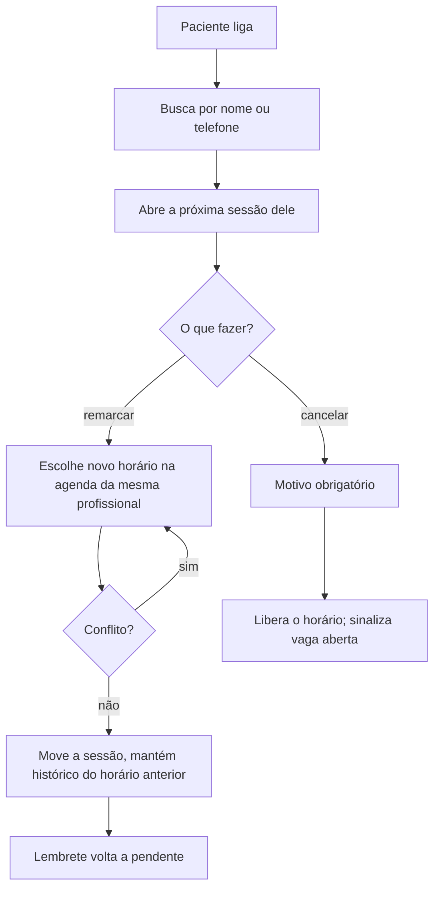

# Etapa 2 — Arquitetura da informação e fluxos

**Base:** `docs/00-descoberta.md` e `docs/01-requisitos.md`.

---

## 1. Sitemap



Rotas em português — é sistema de uso interno, em pt-BR (regra do vault: textos em pt-BR,
código em en-US).

## 2. Navegação por perfil

A sidebar não mostra o que o perfil não pode usar. Esconder e bloquear, nunca só bloquear.

| Item | Dona | Psicóloga | Recepção |
|---|---|---|---|
| Dashboard | ✓ (clínica) | ✓ (própria) | ✓ (operacional do dia) |
| Agenda | ✓ todas | ✓ própria | ✓ todas |
| Pacientes | ✓ todos | ✓ próprios | ✓ todos (cadastro) |
| Prontuários | ✓ metadados | ✓ próprios | ✗ |
| Financeiro | ✓ total | ✓ próprios repasses | ✓ lançamentos |
| Relatórios | ✓ consolidado | ✓ próprios | ✗ |
| Equipe | ✓ | ✗ | ✗ |
| Configurações | ✓ | ✗ | ✗ |
| Auditoria | ✓ | ✗ | ✗ |

## 3. Shell da aplicação

Derivado das 16 referências (`00-descoberta.md §8`), com a paleta do vault:

```
┌──────────────────────────────────────────────────────────────────┐
│ [logo]  Clínica ▾ │  busca…              🔔  [perfil: Dona ▾] │  ← header
├───────────┬──────────────────────────────────────────────────────┤
│ ATENDIMENTO│  Dashboard                                          │
│  Dashboard │  ─────────────                                      │
│  Agenda    │  ┌────┐ ┌────┐ ┌────┐ ┌────┐   ← faixa de 4 KPIs   │
│  Pacientes │  └────┘ └────┘ └────┘ └────┘                        │
│  Prontuário│  ┌──────────────────┐ ┌─────────┐                   │
│            │  │ gráfico dominante│ │satélites│                   │
│ GESTÃO     │  └──────────────────┘ └─────────┘                   │
│  Financeiro│  ┌──────────────────────────────┐                   │
│  Relatórios│  │ tabela / lista               │                   │
│  Equipe    │  └──────────────────────────────┘                   │
│            │                                                     │
│ AJUSTES    │                                                     │
│  Config.   │                                                     │
└───────────┴──────────────────────────────────────────────────────┘
```

Em ≤768 px a sidebar vira bottom nav com os 4 itens principais do perfil; o resto entra em
"Mais".

## 4. Fluxos críticos

### 4.1 Agendar sessão (CA-01)



A checagem de conflito é tripla — profissional, sala e paciente — e a mensagem diz **qual**
dos três conflitou. Erro genérico aqui custa tempo de telefone.

### 4.2 Registrar evolução (CA-02)



O caminho de sucesso — presença, evolução, salvar — cabe em três interações. É o fluxo mais
repetido do sistema (JTBD 2).

### 4.3 Acesso da dona a prontuário de terceiro (CA-03)



Ponto de fricção **deliberado**. A fricção é o produto: torna o acesso raro, rastreável e
consciente.

### 4.4 Faturar convênio e fechar o mês (CA-04)



O elo `sessão → lançamento` é o que o PDF pede em §5 (*"vínculo entre sessão realizada e
lançamento financeiro"*) e é o que quebra na planilha de hoje.

### 4.5 Remarcar (fluxo de maior volume)



Do atendimento ao telefone até a sessão movida: **três telas, no máximo**. Se passar disso,
o sistema falhou no JTBD 1.

## 5. Estados que todo módulo precisa ter

Não são detalhe de acabamento — são o que separa protótipo apresentável de tela quebrada
na reunião.

| Estado | Tratamento |
|---|---|
| Carregando | Skeleton com a forma do conteúdo, nunca spinner solto |
| Vazio por não haver dado | Ilustração leve + o que fazer + botão da ação principal |
| Vazio por filtro | "Nenhum resultado para X" + limpar filtro |
| Sem permissão | Não renderiza; se a rota for acessada direto, tela explicando qual perfil tem acesso |
| Erro | Mensagem em pt-BR, o que aconteceu e o que fazer; nunca stack trace |
| Conflito de agenda | Inline, ao lado do campo, dizendo qual recurso conflitou |
| Ação destrutiva | Confirmação nomeando o que será afetado ("desligar Ana: 23 pacientes passam para…") |

## 6. Onde o protótipo simula

Registrado aqui e repetido no README (regra: nada de mock silencioso).

| Simulado | Como aparece na UI |
|---|---|
| Login | Seletor de perfil no header, rotulado "modo demonstração" |
| Lembrete ao paciente | Botão "enviar" marca como enviado e abre preview da mensagem, com aviso de que nada é enviado |
| Notificação à profissional (acesso justificado) | Entra na tela de notificações interna |
| Assinatura do termo | Desenho em canvas, salvo como imagem — sem validade jurídica |
| Anexos | Base64 no localStorage, com limite de tamanho e aviso |
| Exportação CSV | Real, gerada no client |

## 7. O que ainda não dá para desenhar

Dependem das respostas de `00-descoberta.md §9`:

- **Tela de repasse** (perguntas 2 e 3) — a estrutura muda se for % fixo, por serviço ou
  por convênio, e se as psicólogas são CLT, PJ ou autônomas.
- **Fluxo de guia TISS** (pergunta 7) — se entrar na v1, vira um módulo inteiro.
- **Ajustes de UX guiados pelas dores do sistema atual** (pergunta 4, vídeo não analisado).
