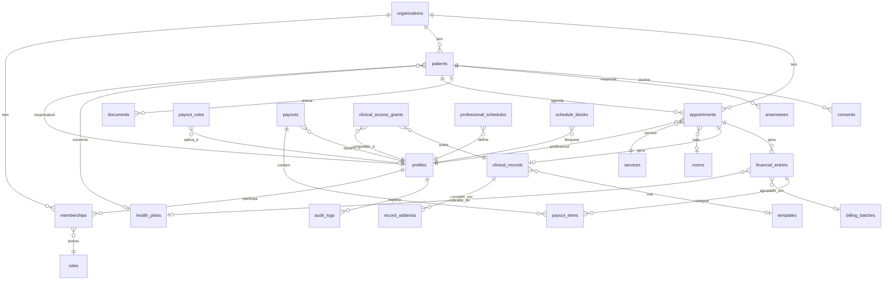

# Etapa 3 — Modelo de dados

**Base:** `docs/01-requisitos.md` + tipos de `_referencia/src/components/health/types.ts` +
tabelas transversais de `_referencia/.lovable/consolidated_schema.sql`.

> O CRM de referência **não tem modelo clínico no banco** (o schema dele é de vendas). O que
> segue foi escrito para este projeto, aproveitando os tipos que existiam só no front.

Decisões aplicadas: sigilo por metadados com acesso justificado (`00-descoberta.md §6`) ·
repasse por percentual, isolado em tabela de regras · `org_id` em toda entidade.

---

## 1. Diagrama



## 2. Dicionário de dados

Todas as tabelas têm `id` (uuid), `org_id` (uuid, FK → `organizations`), `created_at` e
`updated_at`. Abaixo, só o que é específico.

### 2.1 Organização e pessoas

**`organizations`** — a raiz do multi-tenant. Um registro para o consultório, outro para a
clínica.
`name` · `slug` · `type: 'consultorio' | 'clinica'` · `settings jsonb`

**`profiles`** — pessoa, independente de organização.
`full_name` · `email` · `phone` · `avatar_url` · `crp` (registro no conselho, só para quem
atende) · `specialty` · `is_active`

**`memberships`** — vínculo pessoa ↔ organização, e é **aqui** que mora o papel. Uma pessoa
pode ser dona no consultório e psicóloga na clínica.
`profile_id` · `org_id` · `role: 'owner' | 'psychologist' | 'reception'` ·
`status: 'active' | 'deactivated'` · `deactivated_at` · `patients_transferred_to`
(FK → `profiles`, preenchido no desligamento — RF-07.3)

> Não copiamos os cinco papéis do zip (`owner/admin/director/manager/member`). Uma clínica
> de psicologia tem três. `directorate` foi cortado por excesso — registrado aqui como corte
> consciente.

**`role_permissions`** — matriz visível e editável (RF-07.2).
`role` · `permission` · `allowed boolean`

Permissões, com destaque para as duas que o zip fundia numa só:

| Permissão | owner | psychologist | reception |
|---|---|---|---|
| `patient.manage` | ✓ | ✓ (próprios) | ✓ |
| `record.read.own` | ✓ | ✓ | ✗ |
| **`record.read.any`** | **✗** | ✗ | ✗ |
| **`record.read.justified`** | **✓** | ✗ | ✗ |
| `record.metadata.read.any` | ✓ | ✗ | ✓ (sem valor clínico) |
| `appointment.manage.any` | ✓ | ✗ | ✓ |
| `appointment.manage.own` | ✓ | ✓ | ✓ |
| `finance.read.all` | ✓ | ✗ | ✗ |
| `finance.entry.manage` | ✓ | ✗ | ✓ |
| `payout.read.own` | ✓ | ✓ | ✗ |
| `report.read.all` | ✓ | ✗ | ✗ |
| `team.manage` | ✓ | ✗ | ✗ |
| `audit.read` | ✓ | ✗ | ✗ |
| `settings.manage` | ✓ | ✗ | ✗ |

`record.read.any` é **negado a todos**, inclusive à dona. O acesso da dona passa
obrigatoriamente por `record.read.justified`, que cria um registro em
`clinical_access_grants`.

### 2.2 Cadastros

**`health_plans`** — convênios. `name` · `ans_code` · `is_active`
**`services`** — `name` · `duration_minutes` · `is_active`
**`service_prices`** — `service_id` · `health_plan_id` (nulo = particular) · `price numeric`
**`rooms`** — `name` · `is_active`
**`professional_schedules`** — grade padrão. `professional_id` · `weekday 0-6` ·
`start_time` · `end_time`
**`schedule_blocks`** — folga e indisponibilidade. `professional_id` · `starts_at` ·
`ends_at` · `reason` · `recurrence`

### 2.3 Pacientes

**`patients`**
`first_name` · `last_name` · `email` · `phone` · `cpf` · `date_of_birth` · `address` ·
`emergency_contact_name` · `emergency_contact_phone` · `notes` ·
`owner_id` (FK → `profiles`, a psicóloga responsável — **eixo de toda a regra de sigilo**) ·
`payment_type: 'convenio' | 'particular'` · `health_plan_id` · `health_plan_number` ·
`status: 'active' | 'inactive'` · `no_show_count int`

Herdado do zip e **descartado**: `blood_type`, `allergies` — são de clínica geral.

### 2.4 Agenda

**`appointments`**
`patient_id` · `professional_id` · `service_id` · `room_id` · `starts_at` · `ends_at` ·
`status: 'scheduled' | 'confirmed' | 'attended' | 'no_show' | 'cancelled'` ·
`type: 'sessao' | 'avaliacao_inicial' | 'devolutiva' | 'retorno' | 'sessao_grupo'` ·
`is_overbook boolean` (encaixe) · `rescheduled_from uuid` · `cancel_reason` ·
`reminder_sent_at` · `recurrence_group_id` · `created_by`

O enum de status vem do zip sem alteração (já está certo). O de tipo foi reescrito: o
original era de clínica geral (`consulta/retorno/procedimento/avaliacao/urgencia`).

**Invariante da agenda (RF-02.9):** não podem existir dois `appointments` com sobreposição
de intervalo na mesma organização com o mesmo `professional_id`, ou o mesmo `room_id`, ou o
mesmo `patient_id` — desconsiderando os cancelados. Na fase 2 isso vira `EXCLUDE USING gist`
com `tstzrange`; no protótipo é validação no repositório.

### 2.5 Prontuário

**`clinical_records`** — a evolução da sessão. **É a entidade mais protegida do sistema.**
`appointment_id` · `patient_id` · `professional_id` (autor) · `content text` ·
`structured jsonb` · `template_id` · `signed_at` · `is_locked boolean`

**`record_addenda`** — correção após assinatura (RF-04.11). Nunca se edita evolução
assinada.
`record_id` · `author_id` · `content` · `created_at`

**`anamneses`** — `patient_id` · `professional_id` · `template_id` · `answers jsonb`
**`consents`** — `patient_id` · `template_id` · `signature_data text` · `signed_at`
**`documents`** — `patient_id` · `name` · `mime_type` · `size_bytes` · `uploaded_by` ·
`data text` (base64 no protótipo) / `storage_path` (fase 2)
**`templates`** — `kind: 'evolution' | 'anamnesis' | 'consent'` · `name` · `body jsonb` ·
`service_id`

### 2.6 O mecanismo de sigilo

**`clinical_access_grants`** — o coração da regra da `00-descoberta.md §6`. Só existe
registro aqui quando alguém que **não** é a responsável leu conteúdo clínico.

| Campo | Papel |
|---|---|
| `actor_id` | quem acessou |
| `record_id` / `patient_id` | o que foi acessado |
| `reason text NOT NULL` | motivo escrito — sem ele, não há acesso |
| `granted_at` · `expires_at` | acesso por tempo limitado, não permanente |
| `notified_at` | quando a responsável foi avisada |

**`audit_logs`** — trilha geral (RF-04.12).
`actor_id` · `action` · `entity` · `entity_id` · `reason` · `metadata jsonb` · `created_at`

Ações registradas: `record.read`, `record.read.justified`, `record.create`, `record.update`,
`record.sign`, `patient.transfer`, `member.deactivate`, `permission.change`, `export.csv`.

**`notifications`** — `profile_id` · `type` · `payload jsonb` · `read_at`

### 2.7 Financeiro

**`financial_entries`** — um lançamento por sessão atendida (RF-05.1).
`appointment_id` · `patient_id` · `professional_id` · `origin: 'convenio' | 'particular'` ·
`health_plan_id` · `gross_amount numeric(12,2)` ·
`status: 'previsto' | 'faturado' | 'recebido' | 'glosado'` · `billing_batch_id` ·
`due_date` · `paid_at` · `payment_method: 'dinheiro' | 'pix' | 'cartao' | 'convenio'` ·
`glosa_reason` · `tiss_guide_number` (campo reservado, sem uso na v1 — PDF §5)

**`billing_batches`** — lote enviado à operadora.
`health_plan_id` · `period_start` · `period_end` · `status` · `total_amount` · `submitted_at`

**`payout_rules`** — **isolada de propósito.** A regra de repasse não está decidida
(`00-descoberta.md §9`, pergunta 2), então ela vive numa tabela própria e o cálculo fica
num único módulo. Trocar de modelo não toca em mais nada.
`professional_id` (nulo = vale para todos) · `health_plan_id` (nulo = qualquer) ·
`service_id` (nulo = qualquer) · `kind: 'percent' | 'fixed'` · `value numeric` ·
`priority int`

Resolução: vence a regra mais específica (maior `priority`; empate → a que tem menos campos
nulos). Default do protótipo: uma regra `percent 50` por profissional.

**`payouts`** / **`payout_items`** — fechamento mensal (RF-05.8).
`professional_id` · `period_start` · `period_end` · `gross_total` · `payout_total` ·
`status: 'aberto' | 'fechado' | 'pago'` · e os itens ligando a cada `financial_entry`.

## 3. Tipos TypeScript (fonte da verdade no protótipo)

Vivem em `src/lib/domain/types.ts`. Nomes de campo em `snake_case` **de propósito**: são os
mesmos que a fase 2 terá no Postgres, o que elimina uma camada de tradução na migração.

```ts
export type Uuid = string;
export type IsoDateTime = string;

export type Role = 'owner' | 'psychologist' | 'reception';

export type AppointmentStatus =
  | 'scheduled' | 'confirmed' | 'attended' | 'no_show' | 'cancelled';

export type AppointmentType =
  | 'sessao' | 'avaliacao_inicial' | 'devolutiva' | 'retorno' | 'sessao_grupo';

export type EntryStatus = 'previsto' | 'faturado' | 'recebido' | 'glosado';

export interface Patient {
  id: Uuid;
  org_id: Uuid;
  first_name: string;
  last_name: string | null;
  phone: string;
  email: string | null;
  cpf: string | null;
  date_of_birth: string | null;
  owner_id: Uuid;                       // psicóloga responsável
  payment_type: 'convenio' | 'particular';
  health_plan_id: Uuid | null;
  health_plan_number: string | null;
  status: 'active' | 'inactive';
  no_show_count: number;
  created_at: IsoDateTime;
  updated_at: IsoDateTime;
}

export interface Appointment {
  id: Uuid;
  org_id: Uuid;
  patient_id: Uuid;
  professional_id: Uuid;
  service_id: Uuid;
  room_id: Uuid | null;
  starts_at: IsoDateTime;
  ends_at: IsoDateTime;
  status: AppointmentStatus;
  type: AppointmentType;
  is_overbook: boolean;
  rescheduled_from: Uuid | null;
  cancel_reason: string | null;
  reminder_sent_at: IsoDateTime | null;
  created_by: Uuid;
  created_at: IsoDateTime;
  updated_at: IsoDateTime;
}

/** Metadados: o que a dona e a recepção veem sem quebrar sigilo. */
export interface ClinicalRecordMeta {
  id: Uuid;
  appointment_id: Uuid;
  patient_id: Uuid;
  professional_id: Uuid;
  signed_at: IsoDateTime | null;
  created_at: IsoDateTime;
  updated_at: IsoDateTime;
  has_content: boolean;
}

/** Conteúdo: só para a responsável, ou via acesso justificado. */
export interface ClinicalRecord extends ClinicalRecordMeta {
  content: string;
  structured: Record<string, unknown> | null;
  template_id: Uuid | null;
  is_locked: boolean;
}
```

> A separação `ClinicalRecordMeta` / `ClinicalRecord` **em nível de tipo** é o que faz o
> sigilo ser estrutural e não cosmético: um componente que recebe `ClinicalRecordMeta`
> **não compila** se tentar ler `.content`. O TypeScript vira parte do controle de acesso.

## 4. Escopo de acesso

```ts
export interface Scope {
  org_id: Uuid;
  profile_id: Uuid;
  role: Role;
  /** null = toda a organização; array = whitelist de profissionais visíveis. */
  allowed_professional_ids: Uuid[] | null;
  can_read_clinical_content: boolean;   // true só para a responsável
  can_request_justified_access: boolean; // true só para owner
}
```

Herda a ideia de `useDataScope` do zip (whitelist de ids espelhando a RLS no client),
simplificada para três papéis e acrescida das duas flags de sigilo, que o original não tinha.

**Toda função de repositório recebe `Scope` como primeiro argumento.** Não existe leitura
sem escopo — é a mesma regra que a RLS aplica na fase 2, então erro aqui é brecha lá.

## 5. DDL para a fase 2 (extrato)

Completo em `docs/07-backend-seguranca.md`. O essencial:

```sql
create type app_role as enum ('owner','psychologist','reception');
create type appointment_status as enum
  ('scheduled','confirmed','attended','no_show','cancelled');
create type entry_status as enum ('previsto','faturado','recebido','glosado');

create table appointments (
  id uuid primary key default gen_random_uuid(),
  org_id uuid not null references organizations(id) on delete cascade,
  patient_id uuid not null references patients(id),
  professional_id uuid not null references profiles(id),
  service_id uuid not null references services(id),
  room_id uuid references rooms(id),
  starts_at timestamptz not null,
  ends_at timestamptz not null,
  status appointment_status not null default 'scheduled',
  ...
  constraint appointment_valid_range check (ends_at > starts_at)
);

-- A invariante da §2.4, garantida pelo banco e não só pela aplicação:
create extension if not exists btree_gist;
alter table appointments add constraint no_professional_overlap
  exclude using gist (
    professional_id with =,
    tstzrange(starts_at, ends_at) with &&
  ) where (status <> 'cancelled');
-- idem para room_id e patient_id
```

## 6. Volume do seed

Duas organizações, para provar o multi-tenant (RNF-03):

| | Consultório Tatiana | Clínica |
|---|---|---|
| Profissionais | 1 (Tatiana, owner) | 7 psicólogas + Tatiana (owner) + 1 recepção |
| Pacientes | 22 | ~150 |
| Sessões (6 meses) | ~160 | ~1.200 |
| Salas | 1 | 3 |
| Convênios | Petrobras + particular | Petrobras + 2 outros + particular |

Distribuição realista: ~12% de falta, ~7% de cancelamento, alguns encaixes, ocupação
desigual entre profissionais (é o que torna o relatório comparativo legível), e sessões
recorrentes semanais para a maioria dos pacientes ativos — que é como psicologia funciona.
PRNG com semente fixa (RNF-08).

## 7. Pendências deste documento

| Pendência | Efeito |
|---|---|
| Regra de repasse (pergunta 2) | `payout_rules` já isolada; muda só a resolução da regra |
| Convênios além da Petrobras (pergunta 6) | Dados de seed, não estrutura |
| TISS na v1 (pergunta 7) | `tiss_guide_number` reservado; entraria uma tabela de guias |
| Recepção vê que existe prontuário? (pergunta 8) | Uma linha na matriz de permissões |
